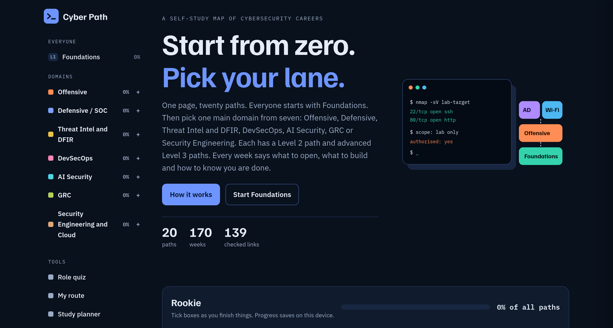
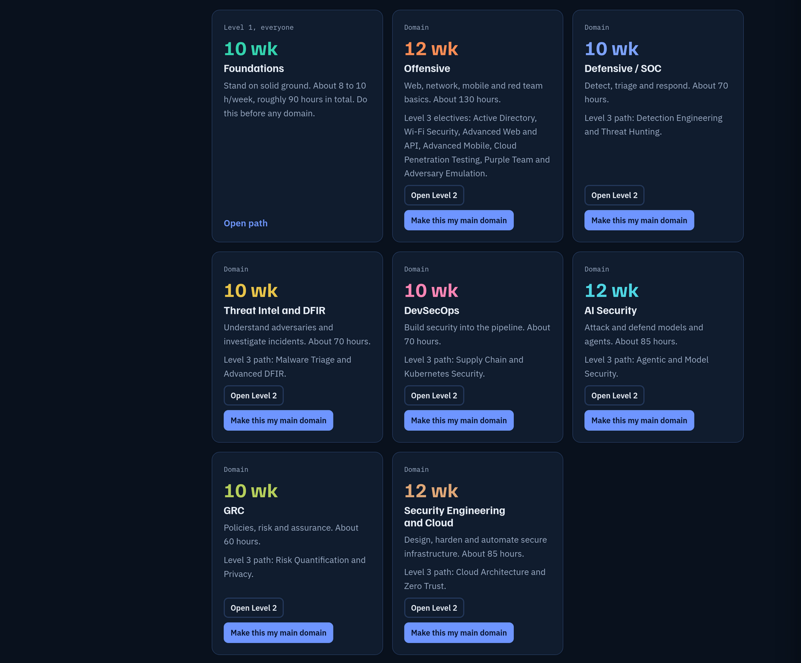
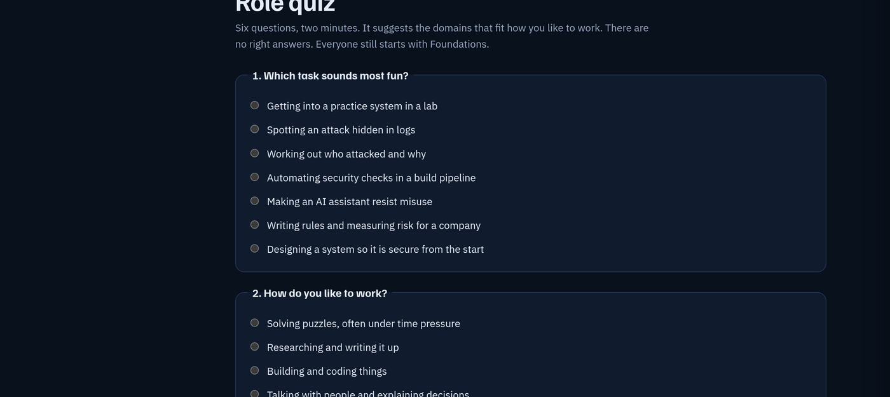

<div align="center">

# Cyber Path

### A self-study map of cybersecurity careers.<br/>One page. Twenty paths. No sign-up.

[](https://arksherx.github.io/cyber-path/)

[](https://creativecommons.org/licenses/by-sa/4.0/)




</div>

---

## What this is

Most people who want to get into security are stopped by the same thing: not a lack of
material, but **too much of it, with no order**. A thousand tutorials and no answer to
*"what do I do on Monday?"*

Cyber Path is one page that answers that. Everyone starts at **Foundations**. Then you
pick one of **eight domains** and work through Level 2, then the advanced Level 3 paths.
Every week tells you **what to open, what to build, and how to know you're done**.

<div align="center">

|  |  |  |  |  |
|:--:|:--:|:--:|:--:|:--:|
| **20** | **170** | **497** | **139** | **8** |
| paths | weeks | steps | checked links | domains |

</div>

---

## The domains



| Domain | Level 2 | Effort | What you'll be able to do | Level 3 path |
|---|:--:|:--:|---|---|
| ⬜ **Foundations** *(everyone starts here)* | 10 wk | ~90 h | Stand on solid ground before any domain | — |
| 🟠 **Offensive** | 12 wk | ~130 h | Web, network, mobile and red team basics | AD, Wi-Fi, Advanced Web & API, Advanced Mobile, Cloud Pentesting, Purple Team, Adversary Emulation |
| 🔵 **Defensive / SOC** | 10 wk | ~70 h | Detect, triage and respond | Detection Engineering and Threat Hunting |
| 🟡 **Threat Intel & DFIR** | 10 wk | ~70 h | Understand adversaries, investigate incidents | Malware Triage and Advanced DFIR |
| 🩷 **DevSecOps** | 10 wk | ~70 h | Build security into the pipeline | Supply Chain and Kubernetes Security |
| 🩵 **AI Security** | 12 wk | ~85 h | Attack and defend models and agents | Agentic and Model Security |
| 🟢 **GRC** | 10 wk | ~60 h | Policies, risk and assurance | Risk Quantification and Privacy |
| 🟧 **Security Engineering & Cloud** | 12 wk | ~85 h | Design, harden and automate secure infrastructure | Cloud Architecture and Zero Trust |

Each domain has **Level 3 electives** — Active Directory, Wi-Fi, Advanced Web & API,
Cloud Pentesting, Purple Team, Detection Engineering, Threat Hunting and more.

---

## Not sure which domain fits you?

**Take the role quiz.** Six questions, two minutes. No right answers — it just suggests
the domains that match how you like to work.



---

## Progress, ranks and badges

Tick boxes as you finish things. Two things track what you've done:

**Path badges.** Finish a path and it earns a badge — *"Offensive complete"*, colour-coded
to that domain. They collect up as you go.

**A rank**, based on how many of the 497 steps you've completed:

| Rank | Steps done |
|---|:--:|
| Rookie | 0 – 9 |
| Apprentice | 10 – 49 |
| Practitioner | 50 – 119 |
| Advanced | 120 – 249 |
| **Specialist** | 250+ |

These are for your own motivation, not credentials — they live in your browser, so nobody
else can verify them and they won't go on a CV. That's the trade for having no account and
no server. Use them to see momentum, not to prove anything.

---

## Why it's built this way

**🔌 The app works offline. The resources it points to don't.**
Worth being precise about this. The page itself — the quiz, the planner, your progress,
your notes, the whole structure — is one self-contained HTML file with no external
scripts, no trackers and no network calls. Fonts are embedded too, so it looks right with
no connection. **The 141 links it points to are on the open internet and do need one.**

In practice that means you can plan your week, tick off what you finished, write your
notes and review your route on a plane or on data you're rationing — then go online only
to open the actual resource. That's deliberate, and it's the part most learning platforms
get wrong.

**🔒 No account. No email. Nothing to sign up for.**
Your progress is stored in your own browser, on your own device. Nobody is collecting
it — there is no server to collect it with.

**📄 It's one file.**
Share it on WhatsApp. Put it on a USB stick. Hand it to a study group where not everyone
has reliable internet.

**⚖️ It takes the legal part seriously.**
Everything here is for legal, authorised learning only, on systems you own or have
written permission to test. The guidance says so explicitly, and names the law.

---

## How to use it

### Just open it — easiest
### → **[arksherx.github.io/cyber-path](https://arksherx.github.io/cyber-path/)**
Works on phone and desktop. Nothing to install.

### Download and keep it
Grab `index.html` and open it in any browser. Works with no internet at all.

```bash
curl -L -o cyber-path.html \
  https://raw.githubusercontent.com/ArksherX/cyber-path/main/index.html
```

### Clone it
```bash
git clone https://github.com/ArksherX/cyber-path.git
cd cyber-path && open index.html     # or xdg-open / start
```

---

> ### ⚠️ Read this before you start ticking boxes
>
> Your progress is saved **in the browser you're using, on the device you're using.**
> It is not synced anywhere, because there's no server.
>
> - Progress on the **website** and on a **downloaded copy** are stored separately
> - Clearing browser data erases it
> - A different device or browser starts fresh
>
> **So use Backup and restore** (in the sidebar). Export your progress to a file and keep
> it. You can restore it on any device, after clearing your browser, or when moving
> between the hosted and downloaded versions. Do this before you have 200 steps to lose.

---

## Contributing

Corrections are genuinely welcome — this gets better when people who used it push back.

**Most useful, in order:**

1. **Dead links.** 139 external links will rot. Reporting one is the single most useful
   thing you can do. There's a checker in the repo:
   ```bash
   python3 check-links.py          # standard library only, nothing to install
   ```
2. **Better free resources** — especially ones accessible outside the US and EU.
3. **Corrections** to anything outdated, wrong, or unclear.
4. **Translations.** Open an issue and it'll be linked from here.

Open an issue, or send a pull request against `index.html`.

**Please don't** submit paid courses you're affiliated with, or swap free resources for
gated ones. The whole point is that someone with no money and a slow connection can
still learn this.

---

## Licence

**[CC BY-SA 4.0](https://creativecommons.org/licenses/by-sa/4.0/)** — Creative Commons
Attribution-ShareAlike.

Share it, adapt it, translate it, print it, teach from it — including commercially.
Two conditions: **credit the original**, and **keep derivatives under the same licence**,
so they stay open for the next person too.

Linked third-party resources belong to their respective owners and carry their own terms.

---

<div align="center">

Built by **[Miracle Owolabi](https://www.linkedin.com/in/miracleowolabi-security)**

*If it helped you, pass it on to someone starting out.*

</div>
